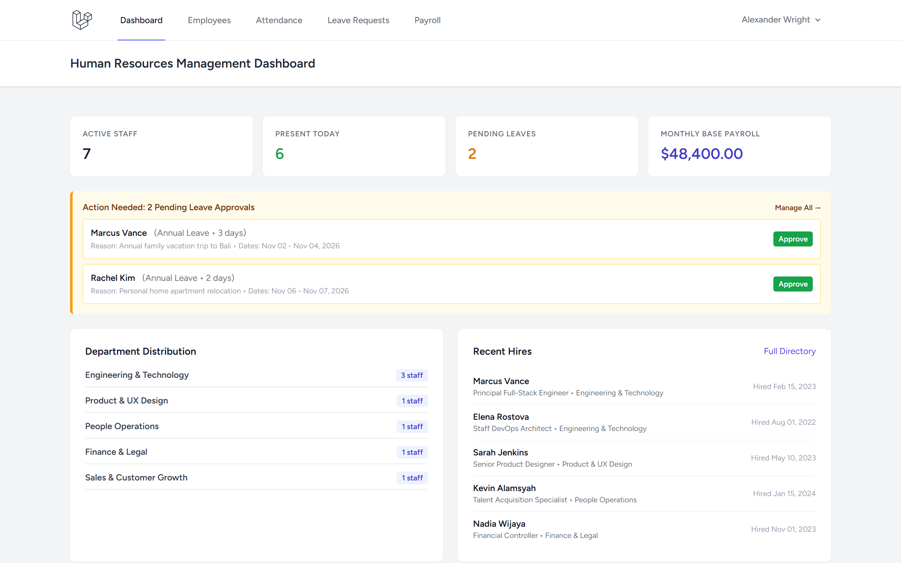
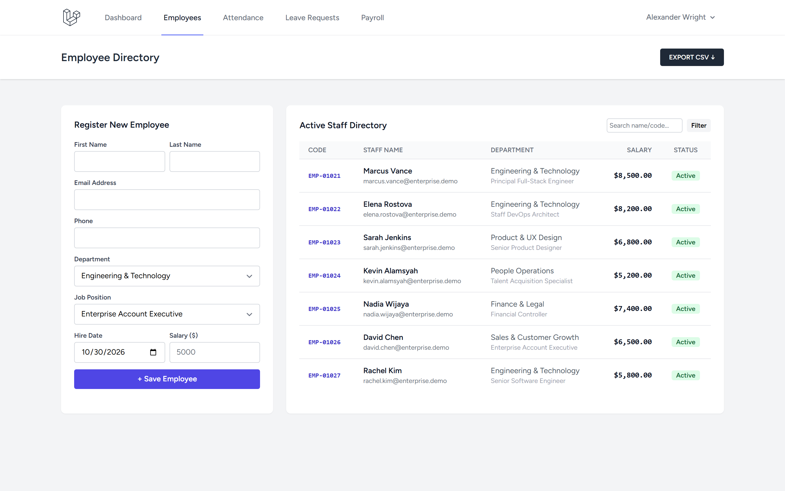
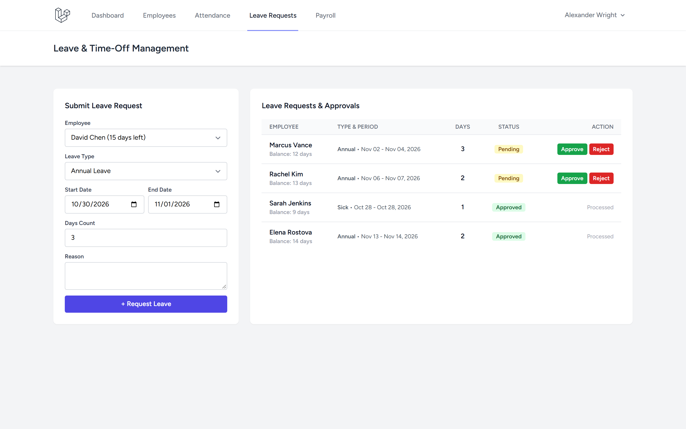
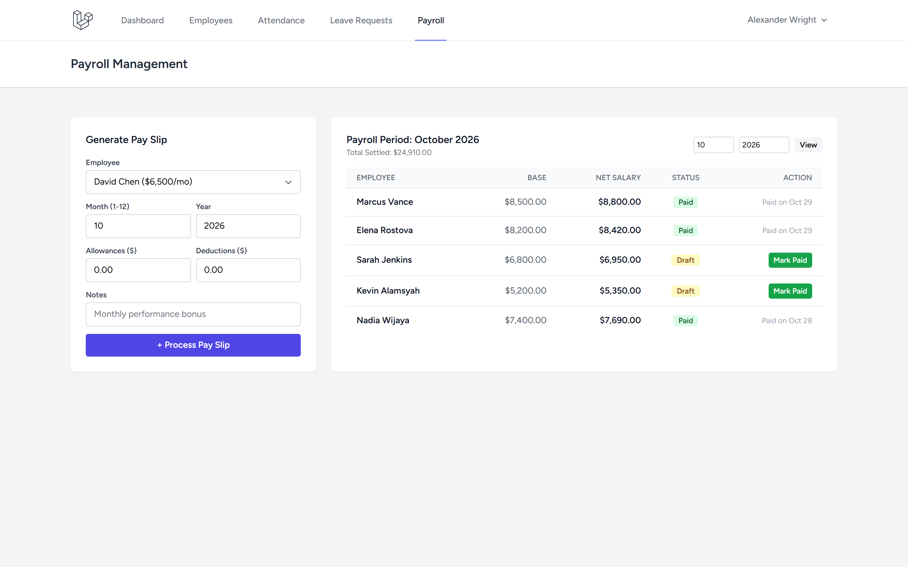

# HR Management System (Laravel)

Human Resource Management platform built with Laravel 11/13, Blade, Tailwind CSS, featuring employee profiles, attendance tracking, leave approval workflows, payroll calculation, and CSV directory exports.

[]()
[]()

---

## 1. Project Overview

The **HR Management System** covers key organizational human capital workflows:
- **Employee Directory**: Staff profiles with unique employee codes (`EMP-XXXXX`), department and position assignments, salary records, and CSV export.
- **Attendance Monitoring**: Daily check-in/check-out logs with status indicators (`present`, `late`, `absent`, `half_day`) and date-based filtering.
- **Leave Requests & Entitlements**: Multi-category leave requests (`annual`, `sick`, `maternity`, `unpaid`), automated balance validation, and approval workflows with balance deduction.
- **Payroll Processing**: Monthly payroll generation calculating base salary + allowances - deductions = net salary, with payment settlement status.
- **HR Dashboard**: Real-time headcount metrics, today's attendance rates, pending leave actions, and departmental distribution.

---

## Screenshots

| Tampilan | Preview |
|---|---|
| **Dashboard Operasional HR**<br>Ringkasan metrik headcount aktif, presensi hari ini, permohonan cuti tertunda, estimasi beban payroll, dan distribusi departemen |  |
| **Direktori Karyawan & Onboarding**<br>Manajemen data staf dengan kode unik pegawai, penugasan posisi/departemen, pencatatan gaji, dan fitur ekspor CSV |  |
| **Alur Pengajuan & Persetujuan Cuti**<br>Formulir permohonan cuti (tahunan/sakit/melahirkan), validasi sisa kuota, dan persetujuan manajerial |  |
| **Administrasi Penggajian (Payroll)**<br>Pemrosesan slip gaji bulanan karyawan, kalkulasi tunjangan & potongan, serta pencatatan status pelunasan (Paid/Draft) |  |

---

## 2. Technology Stack

- **Backend**: Laravel 11/13, Eloquent ORM, Database Transactions
- **Auth**: Laravel Breeze
- **Database**: SQLite (default local & testing) / PostgreSQL compatible
- **Frontend**: Blade + Tailwind CSS + Vite
- **Testing**: PHPUnit / Pest (30 automated tests, 89 assertions)

---

## 3. Quickstart

```bash
# Clone repository
git clone https://github.com/0xyz-exe/hr-management-laravel.git
cd hr-management-laravel

# Setup environment & dependencies
cp .env.example .env
composer install
php artisan key:generate

# Run migrations & seeders
touch database/database.sqlite
php artisan migrate

# Build frontend assets
npm install
npm run build

# Start dev server
php artisan serve
```

---

## 4. Verification

```bash
# Run test suite
php artisan test

# Validate Composer
composer validate

# Audit production npm packages
npm audit --omit=dev
```

---

## 5. License

MIT License. Developed as part of the Laravel Projects Factory.
